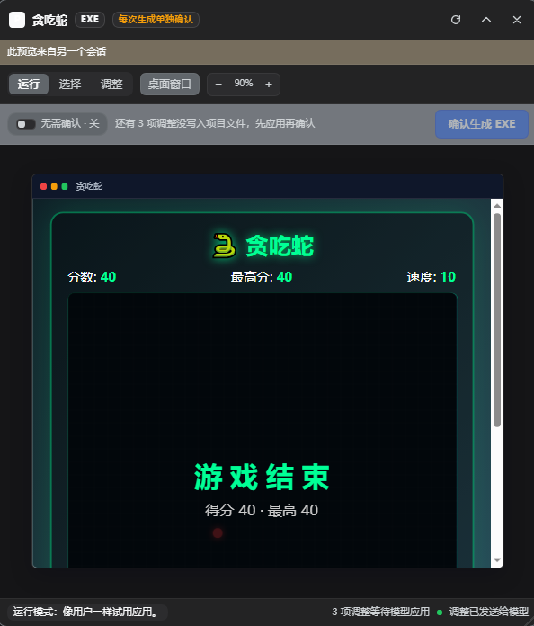

# 实时预览工坊 · Live Preview Studio

[github.com/szsall/dsh-preview-studio](https://github.com/szsall/dsh-preview-studio) · [](https://github.com/szsall/dsh-preview-studio/actions/workflows/test.yml)

> [!WARNING]
> **实验版 / Experimental.** 只在 **DeepSeek Harness 桌面版 0.2.1-rc.2** 上成功运行过。作者发布它，主要是想看看在其它版本、其它环境里能不能用；不保证兼容性，接口和行为都可能变化，请先备份项目再试。
>
> Only tested on **DeepSeek Harness Desktop 0.2.1-rc.2**. This is an experiment published to find out whether it works elsewhere. No compatibility guarantees.

给 DeepSeek Harness 桌面端用的插件：当你要做 **EXE** 或 **安卓 APK** 时，先在 Harness 里打开一个「和运行后长得一样」的实时预览窗口，试用、点选、可视化调整，**每次生成前由用户确认**（也可在面板里开启「无需确认」）之后模型才允许打包。




*实时预览面板：运行 / 选择 / 调整模式，「无需确认」开关，以及待应用调整提示。*

## 它解决什么

传统流程里，想看一眼桌面端 / 安卓界面，必须打包、安装、运行，改一个字都要重来一遍。这个插件把顺序倒过来：

1. 模型先把界面做成可运行的 Web 产物（Flutter Web、Tauri/Electron 渲染层、React/Vue 构建产物，或一份忠实还原的 HTML）；
2. 插件用独立的本地预览源把它跑起来，浮窗里就是应用本体；
3. 你像用户一样试用；切到 **选择** 模式点任意元素，模型下一次对话就能拿到元素定位 + 候选源码位置，精准改代码；
4. 切到 **调整** 模式直接拖拽、缩放、旋转、改文字和颜色，调整会同步给模型，模型改完项目文件后窗口自动刷新；
5. 满意后点 **确认生成**，本次打包获准；模型执行一次打包后确认即被消耗，下次生成需要再次确认（或开启「无需确认」）。

实时窗口可以拖动、缩放、收起成右下角小胶囊，也可以随时关闭。

## 安装

要求：DeepSeek Harness（带 Web UI 的桌面端或 `dsh web`），Node.js 20+。

```bash
git clone https://github.com/szsall/dsh-preview-studio.git
```

在 Harness 里让模型安装克隆下来的 bundle（绝对路径）：

```text
plugin_manager install_bundle  target = <克隆目录>
```

安装并激活后，右下角会出现预览浮窗（有预览时），插件列表里显示「实时预览工坊」。

## 兼容性 / Compatibility

- **已成功运行**：DeepSeek Harness **桌面版 0.2.1-rc.2**（Windows，Web UI）。
- **未验证**：其它 DSH 版本、单独运行的 `dsh web`、macOS/Linux、不同的插件加载方式。
- 这是实验版：预览注入、面板 API、打包守卫都可能随 DSH 版本变化而失效。
- 如果你在别的版本/系统上跑通或跑不通，欢迎开 issue 并附上：
  DSH 版本、操作系统、失败现象或日志、复现步骤。仓库提供了兼容性报告模板。

## 打开 / 收起 / 重新打开

实时窗口不是常驻面板：**只有当前存在预览时才会出现**。

- **第一次打开**：在对话里说「做一个桌面/安卓应用」或「给 `clock-app` 打开实时预览」，模型调用 `preview_studio`（action `open`）后，浮窗自动出现。
- **收起**：点浮窗右上角「收起」，会变成右下角小胶囊；点胶囊展开，胶囊可以拖动。收起**不会**停止预览，选中和调整都会保留。
- **关闭**：点 × 会停止预览服务。关闭后没有可恢复的预览，需要再对模型说一次「重新打开实时预览」「给 `clock-app` 开预览」，会创建一个新预览。
- **新会话**：插件工具在所有会话可用，但新会话默认没有预览；说「给 `clock-app` 打开实时预览」即可。预览属于打开它的会话，会话结束/关闭时会停止；浮窗同时只显示最近打开的那个预览，若它属于其它会话，会显示「来自另一个会话」。
- **浮窗不见了**：先看窗口右下角有没有小胶囊；没有就说明预览已关闭，让模型重新打开即可。

预览的 `root` 就是你要展示的 Web 构建目录（例如 `clock-app`）；同一个目录可以在任意会话重新打开。

## 模型侧工作流

插件向所有会话注入一段 Preview Studio 策略，并注册 4 个工具：

| 工具 | 作用 |
|---|---|
| `preview_studio` | `action: open / status / refresh / close / built`。`open` 需要 `root`（Web 构建目录或 HTML 文件）、可选 `entry`、`target: exe\|apk`、`title`、`build`（计划执行的打包命令）。 |
| `preview_inspect` | 读取当前选中元素、待应用的调整项、DOM 定位与候选源码 `文件:行号`。 |
| `preview_ack` | 模型改完项目文件后调用：清空调整列表并刷新实时窗口。 |
| `preview_release` | 打包闸门。返回 `confirmed: true` 时代表**本次**打包获准；该确认会被消耗，下次生成需要重新确认。 |

另外，打包命令（`flutter build apk`、`gradlew assemble`、`electron-builder`、`tauri build`、`pyinstaller`、`dotnet publish`、`msbuild`、`build.ps1` 等）在预览未确认时会被工具守卫直接拒绝。

## 一次确认 = 一次生成 / 无需确认

- **每次生成单独确认**：点击「确认生成」只批准一次打包。`preview_release` 会消耗这次确认，工具守卫在放行打包命令时消耗一次性许可；再生成必须重新点击确认。
- **改动即失效**：确认后如果项目源码变化、又有新的调整，确认会自动失效。
- **无需确认**：确认栏左侧的「无需确认 · 开/关」按钮，**默认关闭**。
  - 开启：模型可以直接执行打包命令，也可以继续点「确认生成」；不再逐次要求确认。
  - 关闭：立即恢复逐次确认，并清掉之前的确认/放行状态，**不会继承开启时的效果**。
  - 该状态只对当前预览有效，重新打开预览会回到默认关闭。

一个典型请求：

> 帮我做一个 Windows 桌面待办软件，先给我看看界面。

模型应当：

```text
preview_studio  action=open  root=dist  target=exe  title=待办清单  build="npm run dist"
```

然后你试用、选择、调整、点确认，模型收到唤醒消息后：

```text
preview_release  → confirmed: true, build: "npm run dist"
bash             → npm run dist
preview_studio   action=built artifact="release/待办清单 Setup.exe"
```

## 预览适配约定（重要）

「实时窗口和安装后一样」建立在**同一套界面代码**上：

- **Flutter**：`flutter build web --release`，`root` 指向 `build/web`。
- **Tauri / Electron**：前端生产构建（Vite `npm run build` 的 `dist`），`root` 指向该目录。
- **React / Vue / 原生 HTML**：构建产物或源码目录。
- **Android 原生（Compose/XML）/ iOS 原生**：浏览器无法直接渲染原生 UI。此时让模型先做一份与原生界面一致的 Web 还原版作为预览，再写原生代码；插件会在 `target=apk` 时套上手机边框。
- 预览使用独立的本机源（随机端口），因此 `/assets/...` 这类绝对路径、ES Module、相对 `fetch` 都能正常工作；不需要改 `base`。
- `entry` 默认 `index.html`；`root` 也可以直接传一个 HTML 文件。

## 选择 / 调整模式

- **运行**：完全不拦截事件，正常点击、输入、滚动。
- **选择**：支持连续多选——点击元素加入选择（每个都有蓝色选框并一直保留），再点同一元素取消，`Esc` 清空；最后一次点击的是主选元素。宿主会为每个选中元素在项目源码中搜索文字、id、class、`data-testid` 等特征，给出候选 `文件:行号`，并在下一次模型调用时通过该会话的动态上下文（runtime context）一并提供给模型。
- **调整**：拖动移动，8 个角点缩放，顶部圆点旋转；属性面板可精确设置 X/Y、宽/高、旋转、**字号**、文字、文字颜色、背景色；双击文字元素可直接改字；工具栏「撤销」或 **Ctrl+Z** 撤回上一次调整。所有调整先在本机预览中生效，约 0.7s 后汇总同步给模型。
- **缩放预览**：工具栏 `− 100% ＋` 可在 50%–200% 之间缩放预览画面，点百分比恢复 100%。
- 模型改完文件后调用 `preview_ack`，窗口自动重载；如果你正在调整且还有未应用的修改，会提示手动刷新，避免覆盖。
- 浮窗右上角「收起」后变成右下角胶囊，**胶囊可以拖动**到任意位置，点一下重新展开。

> 实现说明：选择与调整不写入 user 消息，而是注册为 agent 作用域的 `systemPrompt.context`，随 `runtime-context` 快照进入下一次模型请求。会话格式 v4 已弃用 `{ kind: 'plugin' }` 源，这种写法既避免格式校验失败，也不会在对话里留下伪造的用户消息。

## 已知边界

- 预览的是 **Web 可渲染的界面**；原生控件、系统菜单、真实窗口阴影等只能近似。
- 源码定位是启发式搜索（构建产物没有 source map 时尤其如此），候选位置需要模型打开文件确认。
- 元素选中依赖注入的检查器脚本；若页面 CSP 禁止内联样式或脚本，运行模式仍可用，但选择/调整会提示未连接。
- 预览服务只监听 `127.0.0.1` 随机端口，不会暴露到局域网；关闭预览或会话结束即释放。

## 目录

```text
preview-studio/
  index.js               Host 插件：工具、提示词、打包守卫、面板 API
  client.js              浏览器浮窗：运行/选择/调整、属性面板、确认按钮
  preview-inspector.js   注入到预览页的检查器（选择、拖拽、缩放、旋转、改字）
  lib/preview-server.js  独立预览源 + HTML 注入
  lib/studio.js          预览状态、文件监听、上下文注入、API、闸门
  lib/source-map.js      选中元素 -> 候选源码位置
  locale/{zh,en}.json    插件管理页显示信息
  test/preview.test.mjs  Host 核心自测（64 项）
  demo/                  自测用的静态页面
```

## 开发自测

```bash
node test/preview.test.mjs
```

覆盖静态预览源、检查器注入、路径穿越防护、SPA 回退、源码候选、状态 API、选择/调整同步、确认闸门、文件监听自动刷新。

## License

[MIT](./LICENSE) © 2026 szsall
